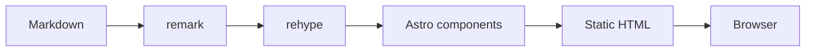
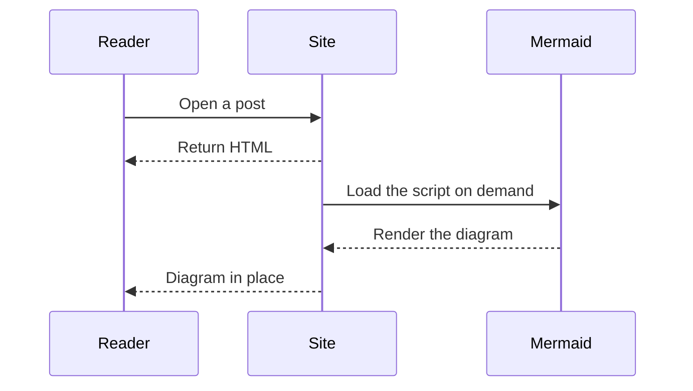

This post doubles as a sample and a cheat sheet. Each section shows one feature with real content instead of a syntax dump, so you can copy the structure into your own posts.

## Headings and the table of contents

Body copy starts at level two. Every `h2` and `h3` is collected into the table of contents panel and highlighted as you scroll; `h4` and below only affect visual hierarchy.

### Level three joins the TOC

Keep the outline within three levels. If a section needs a fourth, it usually wants to be its own post.

#### Level four only changes typography

Smaller type, tighter spacing, no entry in the TOC.

### Heading anchors

Hover any heading and a link icon appears at the end of the line. Clicking it puts the `#fragment` in the address bar, so you can link straight to a section.

## Inline formatting

A paragraph with **bold**, *italic*, ***bold italic***, ~~strikethrough~~ and `inline code`, ending with a [regular link](https://astro.build).

Keyboard keys are plain HTML: press <kbd>Ctrl</kbd> + <kbd>K</kbd> to open search, <kbd>Esc</kbd> to close it.

## Lists

### Unordered

- First item
- Second item
  - Nested item
  - Another nested item
    - Third level still renders
- Back to the top level

### Ordered

1. Install dependencies
2. Start the dev server
   1. Default port is 4321
   2. Pass `--port` when it is taken
3. Build the output

### Tasks

- [x] Set the site title and description
- [x] Replace the sample posts
- [ ] Point the site at your own domain
- [ ] Enable comments and analytics

## Tables

| Option | Type | Default | Purpose |
|:--|:--:|--:|:--|
| `lang` | string | `en` | UI copy language |
| `theme` | string | `default` | One of twelve color schemes |
| `contentWidth` | number | `720` | Max width of the article column |
| `backdropBlur` | number | `12` | Blur radius behind floating panels |

Alignment is controlled by the colon position in the separator row.

## Quotes and alerts

Plain blockquotes keep the quiet default styling:

> A good theme should be invisible while you read.
>
> It only needs to put the right control within reach.

Alerts follow GitHub's syntax and come in five colors:

> [!NOTE]
> Background information that helps but does not block the main thread.

> [!TIP]
> A shortcut that saves a step.

> [!IMPORTANT]
> A prerequisite. Skipping it costs time later.

> [!WARNING]
> Something that can lose data if done carelessly.

> [!CAUTION]
> High risk. Back up first.

Append `+` or `-` to make the block collapsible, and write your own title after the marker:

> [!NOTE]+ Click the title to collapse this block
> Collapsible alerts use native `<details>`, so they cost no JavaScript. Handy for long background notes or troubleshooting logs.

## Code blocks

Inline code sits in backticks, like `pnpm dev`. Fenced blocks take a language and get a label plus a copy button:

```ts
type Post = {
  title: string
  date: Date
  tags: string[]
}

const byDate = (a: Post, b: Post) => b.date.getTime() - a.date.getTime()

export const latest = (posts: Post[], count = 5) =>
  [...posts].sort(byDate).slice(0, count)
```

Shell commands work the same way:

```bash
pnpm install
pnpm dev
pnpm build
```

Blocks longer than 30 lines collapse by default and offer an expand button, so a long file does not swallow the page. The threshold lives in `siteConfig.codeblock.collapse`.

```ts
// Long enough to trigger the collapse control
export type ThemeName =
  | "default"
  | "claude"
  | "supabase"
  | "vercel"
  | "nord"
  | "gruvbox"

type ThemeTokens = {
  background: string
  foreground: string
  primary: string
  muted: string
  border: string
}

const tokens: Record<ThemeName, ThemeTokens> = {
  default: {
    background: "oklch(1 0 0)",
    foreground: "oklch(0.2 0 0)",
    primary: "oklch(0.55 0.2 260)",
    muted: "oklch(0.96 0 0)",
    border: "oklch(0.9 0 0)",
  },
  claude: {
    background: "oklch(0.98 0.01 80)",
    foreground: "oklch(0.25 0.02 60)",
    primary: "oklch(0.6 0.14 40)",
    muted: "oklch(0.94 0.01 80)",
    border: "oklch(0.89 0.01 80)",
  },
  supabase: {
    background: "oklch(0.18 0.01 160)",
    foreground: "oklch(0.95 0 0)",
    primary: "oklch(0.7 0.15 160)",
    muted: "oklch(0.24 0.01 160)",
    border: "oklch(0.3 0.01 160)",
  },
  vercel: {
    background: "oklch(1 0 0)",
    foreground: "oklch(0 0 0)",
    primary: "oklch(0 0 0)",
    muted: "oklch(0.97 0 0)",
    border: "oklch(0.92 0 0)",
  },
  nord: {
    background: "oklch(0.24 0.02 240)",
    foreground: "oklch(0.93 0.01 220)",
    primary: "oklch(0.72 0.08 210)",
    muted: "oklch(0.3 0.02 240)",
    border: "oklch(0.36 0.02 240)",
  },
  gruvbox: {
    background: "oklch(0.25 0.03 70)",
    foreground: "oklch(0.92 0.04 85)",
    primary: "oklch(0.75 0.14 75)",
    muted: "oklch(0.31 0.03 70)",
    border: "oklch(0.38 0.03 70)",
  },
}

export const theme = (name: ThemeName): ThemeTokens => tokens[name]
```

## Math

Inline math sits in the sentence, like $E = mc^2$ or $a^2 + b^2 = c^2$, and stays aligned with the baseline without stretching the line height.

Display math gets its own block:

$$
\int_{-\infty}^{\infty} e^{-x^2}\,\mathrm{d}x = \sqrt{\pi}
$$

Matrices work too:

$$
\begin{pmatrix} a & b \\ c & d \end{pmatrix}
\begin{pmatrix} x \\ y \end{pmatrix}
=
\begin{pmatrix} ax + by \\ cx + dy \end{pmatrix}
$$

KaTeX runs at build time, so the output is static HTML. No JavaScript, no flash of raw `$...$` before the formula appears.

## Diagrams

`mermaid` blocks are rendered in the browser by Mermaid, and the script is only loaded on pages that actually contain one:



Sequence diagrams:



Diagrams redraw when you switch between light and dark, so you never get a white-background image on a dark page.

## Images and galleries

Adjacent images are grouped into a gallery with layout switching and a lightbox. The caption comes from the title attribute.


A single image stays a plain figure:


## Details

Native `<details>` works as-is, which is a decent place for appendices or long logs:

<details>
<summary>Show the build output</summary>

```
17:42:01 [build] output: "static"
17:42:01 [build] directory: dist/
17:42:03 [build] ✓ Completed in 1.82s
17:42:05 [build] 36 page(s) built in 4.82s
17:42:05 [build] Complete!
```

Any Markdown works inside, not just plain text.

</details>

## Footnotes

Body text can carry a footnote[^build], and the reader can jump to it and back[^note].

[^build]: Footnotes suit sources, extra data, or explanations that would interrupt the flow.

[^note]: Numbered and named references both work; named ones survive reordering better.

## Front matter and per-page overrides

A post's front matter covers more than the title and date:

```yaml
title: "Theme Tour"
date: 2026-10-19T09:00:00+08:00
cover: "/images/og-default.avif"
categories: ["Guide"]
tags: ["Astro", "Markdown"]
series: "Getting Started"
series_order: 1
toc: true
comments: false
katex: true
mermaid: true
lightbox: true
license: "CC BY-ND 4.0"
```

`series` and `series_order` group posts without changing the URL: each part stays its own page and the article header shows progress through the series. The toggles override the site defaults per post, and `license` replaces the footer notice for this article only.

For embeds such as buttons, link cards, tabbed panels and video players, rename the file to `.mdx` and import the components from `src/components/embeds/`. The Chinese sample in this repository, `mdx-embeds.mdx`, shows each of them in use.
