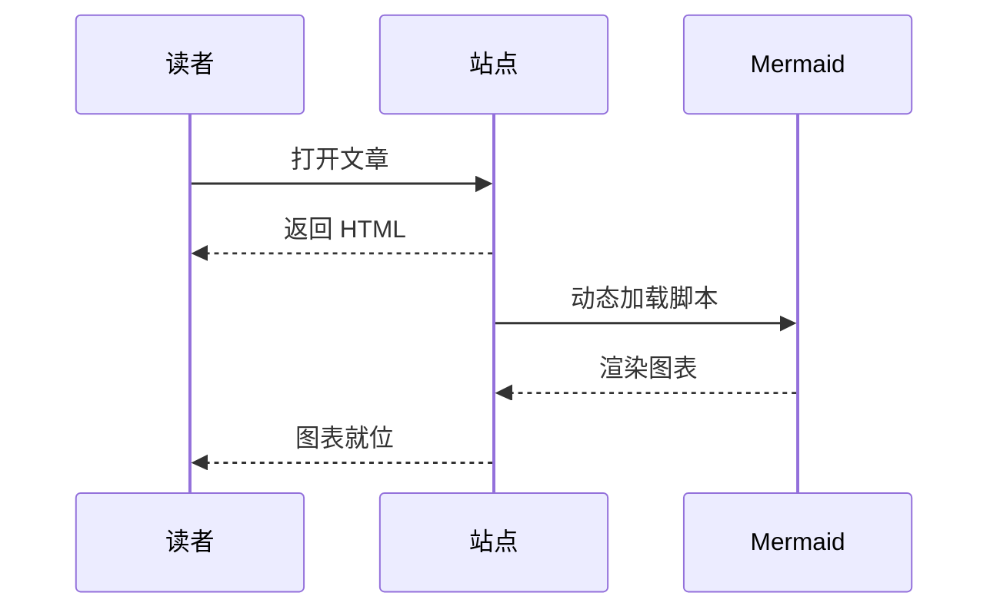

这篇既是示例也是速查表：每一节都用真实内容演示一种写法，写文章时照着抄结构就行。front matter、站点配置和页面级开关放在同系列的后两篇。

## 标题与目录

正文从二级标题开始。渲染时 `h2` 和 `h3` 会收进右侧目录面板，滚动到哪一节就高亮哪一条；`h4` 以下只做视觉层级，不进目录。

### 三级标题同样进目录

层级保持在三层以内，目录读起来最清楚。再深的结构，通常说明这一节该拆成独立文章了。

#### 四级标题只影响排版

字号和间距会逐级收窄，但不参与目录和滚动高亮。

### 标题锚点

鼠标移到任意标题上，行尾会出现一个链接图标。点它，地址栏就带上 `#片段`，可以直接把某一节分享给别人。

## 行内格式

一段包含 **加粗**、*斜体*、***加粗斜体***、~~删除线~~ 和 `inline code` 的正文，末尾放一个[普通链接](https://astro.build)。

键盘按键用原生 HTML 写：按 <kbd>Ctrl</kbd> + <kbd>K</kbd> 打开搜索，按 <kbd>Esc</kbd> 关闭。

## 列表

### 无序列表

- 一级条目
- 另一个一级条目
  - 二级条目，靠缩进两格
  - 同级的第二条
    - 三级条目照样能渲染
- 回到一级

### 有序列表

1. 第一步，先安装依赖
2. 第二步，跑本地预览
   1. 默认端口 4321
   2. 端口占用时用 `--port` 换一个
3. 第三步，构建产物

### 任务列表

- [x] 配置站点信息
- [x] 换掉示例文章
- [ ] 绑定自己的域名
- [ ] 配上评论和统计

## 表格

| 字段 | 类型 | 默认值 | 说明 |
|:--|:--:|--:|:--|
| `lang` | 字符串 | `zh-hans` | 界面文案语言 |
| `theme` | 字符串 | `default` | 配色，共 12 套 |
| `contentWidth` | 数字 | `720` | 正文最大宽度 |
| `backdropBlur` | 数字 | `12` | 浮层背景模糊半径 |

三列对齐方式分别是左对齐、居中、右对齐，用 `:` 的位置控制。

## 引用与提示框

普通引用保持朴素样式，适合摘录原文：

> 好的主题不该让读者注意到主题本身。
>
> 它只需要在读者需要的时候，把信息放在顺手的位置。

提示框用 GitHub 的写法，一共五种颜色：

> [!NOTE]
> 补充说明，用来解释背景，不打断阅读节奏。

> [!TIP]
> 一条更省事的做法，读者跳过也不影响理解。

> [!IMPORTANT]
> 必须知道的前提，漏掉会走弯路。

> [!WARNING]
> 可能导致数据丢失的操作，动手前先看清楚。

> [!CAUTION]
> 高风险操作，执行前务必备份。

标记后面加 `+` 或 `-` 就变成可折叠的区块，`+` 默认展开、`-` 默认收起，标题也能自己写：

> [!NOTE]+ 点标题可以收起这块内容
> 折叠用的是原生 `<details>`，不需要加载任何脚本。适合放一段较长的背景资料或者排查记录。

## 代码块

行内代码用反引号包住，比如 `pnpm dev`。独占一段的代码块标上语言，右上角会显示语言名和复制按钮：

```ts
type Post = {
  title: string
  date: Date
  tags: string[]
}

const byDate = (a: Post, b: Post) => b.date.getTime() - a.date.getTime()

export const latest = (posts: Post[], count = 5) =>
  [...posts].sort(byDate).slice(0, count)
```

配置文件同样支持语言标记：

```bash
pnpm install
pnpm dev
pnpm build
```

超过 30 行的代码块默认折叠，右下角给出展开按钮，避免一整屏都是代码。这个阈值可以在 `siteConfig.codeblock.collapse` 里改。

```ts
// 这一段故意写长，用来看折叠按钮
export type ThemeName =
  | "default"
  | "claude"
  | "supabase"
  | "vercel"
  | "nord"
  | "gruvbox"

type ThemeTokens = {
  background: string
  foreground: string
  primary: string
  muted: string
  border: string
}

const tokens: Record<ThemeName, ThemeTokens> = {
  default: {
    background: "oklch(1 0 0)",
    foreground: "oklch(0.2 0 0)",
    primary: "oklch(0.55 0.2 260)",
    muted: "oklch(0.96 0 0)",
    border: "oklch(0.9 0 0)",
  },
  claude: {
    background: "oklch(0.98 0.01 80)",
    foreground: "oklch(0.25 0.02 60)",
    primary: "oklch(0.6 0.14 40)",
    muted: "oklch(0.94 0.01 80)",
    border: "oklch(0.89 0.01 80)",
  },
  supabase: {
    background: "oklch(0.18 0.01 160)",
    foreground: "oklch(0.95 0 0)",
    primary: "oklch(0.7 0.15 160)",
    muted: "oklch(0.24 0.01 160)",
    border: "oklch(0.3 0.01 160)",
  },
  vercel: {
    background: "oklch(1 0 0)",
    foreground: "oklch(0 0 0)",
    primary: "oklch(0 0 0)",
    muted: "oklch(0.97 0 0)",
    border: "oklch(0.92 0 0)",
  },
  nord: {
    background: "oklch(0.24 0.02 240)",
    foreground: "oklch(0.93 0.01 220)",
    primary: "oklch(0.72 0.08 210)",
    muted: "oklch(0.3 0.02 240)",
    border: "oklch(0.36 0.02 240)",
  },
  gruvbox: {
    background: "oklch(0.25 0.03 70)",
    foreground: "oklch(0.92 0.04 85)",
    primary: "oklch(0.75 0.14 75)",
    muted: "oklch(0.31 0.03 70)",
    border: "oklch(0.38 0.03 70)",
  },
}

export const theme = (name: ThemeName): ThemeTokens => tokens[name]
```

## 数学公式

行内公式直接夹在句子里，比如质能方程 $E = mc^2$，或者勾股定理 $a^2 + b^2 = c^2$。行内公式会和正文基线对齐，不会把行距撑开。

独占一行的块级公式：

$$
\int_{-\infty}^{\infty} e^{-x^2}\,\mathrm{d}x = \sqrt{\pi}
$$

矩阵和分段函数也能写：

$$
\begin{pmatrix} a & b \\ c & d \end{pmatrix}
\begin{pmatrix} x \\ y \end{pmatrix}
=
\begin{pmatrix} ax + by \\ cx + dy \end{pmatrix}
$$

公式在构建时就用 KaTeX 渲染成静态 HTML，不依赖浏览器执行 JavaScript——关掉脚本也能正常显示，也不会出现先看到 `$...$` 原文再"跳"成公式的闪动。

## 流程图与时序图

`mermaid` 代码块交给 Mermaid 在浏览器里画图，只在确实有图的页面才加载脚本：


时序图：



图表会跟随明暗切换重新绘制，不会出现深色背景配白底图片的情况。

## 图片与画廊

相邻的图片会自动聚成一组，支持切换布局和点开灯箱；图片下面那行说明来自链接的 title 属性。


单独出现的图片不参与聚合，就是普通插图：


## 折叠内容

原生 `<details>` 也能直接用，适合放附录、长清单或者大段日志：

<details>
<summary>点开看构建输出的样子</summary>

```
17:42:01 [build] output: "static"
17:42:01 [build] directory: dist/
17:42:01 [build] Collecting build info...
17:42:03 [build] ✓ Completed in 1.82s
17:42:05 [build] 36 page(s) built in 4.82s
17:42:05 [build] Complete!
```

里面可以放任意 Markdown，不只是纯文本。

</details>

## 脚注

正文里可以挂脚注[^build]，读者点击就跳到文末对应的条目，再点回来[^note]。

[^build]: 脚注适合放引用来源、补充数据或者与主线关系不大的解释。

[^note]: 编号和命名两种写法都支持，命名写法在增删内容时不容易错位。

## 接下来

同系列的下一篇讲 MDX 组件：按钮、链接卡、标签页和视频嵌入——那些写法需要把文件后缀改成 `.mdx`。
