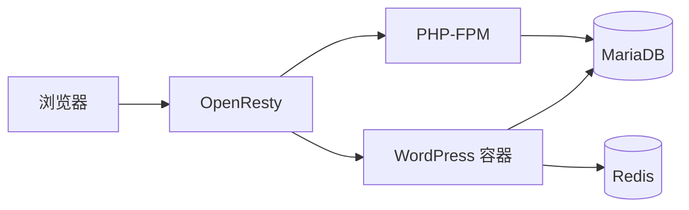
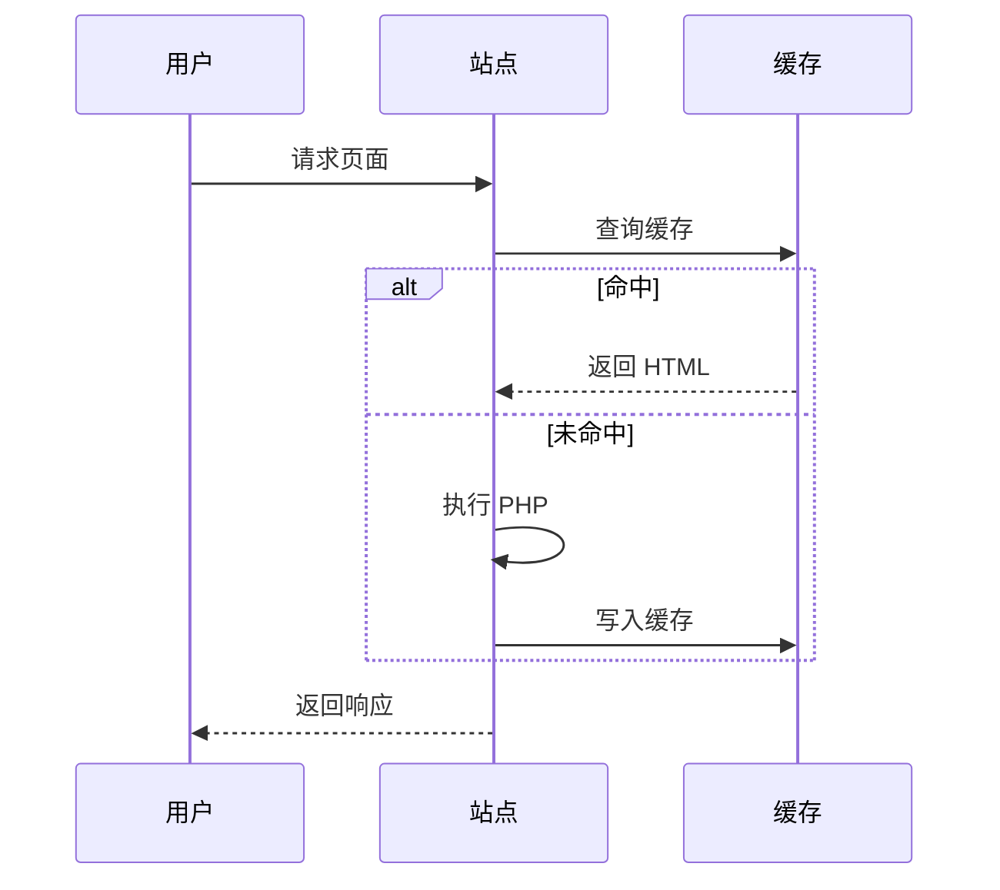

上游用 CDN 在浏览器里跑 KaTeX 和 Mermaid；这里数学公式在构建时就渲染成静态 HTML，图表仍然留给浏览器。

## 行内公式

质能方程 $E = mc^2$ 是最常见的那一个。行内公式应该和正文基线对齐，不撑高行距。

再看一个带下标的：$a_1^2 + a_2^2 = c^2$。

## 块级公式

高斯积分：

$$
\int_{-\infty}^{\infty} e^{-x^2} \, dx = \sqrt{\pi}
$$

矩阵也能写：

$$
\begin{pmatrix}
a & b \\
c & d
\end{pmatrix}
\begin{pmatrix}
x \\
y
\end{pmatrix}
=
\begin{pmatrix}
ax + by \\
cx + dy
\end{pmatrix}
$$

## 流程图

## 时序图

公式是静态的，关掉 JavaScript 也能看；图表需要脚本，所以只在含 `mermaid` 代码块的页面加载。
