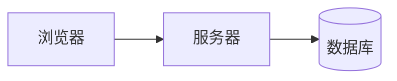

这篇本身就是演示：它的 front matter 关掉了目录、公式、图表、灯箱和评论，还把授权协议改成了另一套。你现在看到的页面就是"关掉之后"的样子。

## 写了什么

```yaml
toc: false
katex: false
mermaid: false
lightbox: false
comments: false
license: "CC BY-ND 4.0"
```

每一项都是可选的，不写就跟随站点配置。布尔值和对象两种写法等价，`katex: false` 和 `katex: { enabled: false }` 效果一样。

## 关掉目录

因为没有目录，页面右侧不会出现目录面板，浮动 dock 上的目录按钮也一并隐藏——不会留下一个点了没反应的按钮。

## 关掉公式

公式不再转换成排版好的样子，而是保持原文：

质能方程 $E = mc^2$。

$$
\int_{-\infty}^{\infty} e^{-x^2}\,\mathrm{d}x = \sqrt{\pi}
$$

这两行现在就是 Markdown 原文。适合那些只是举例提到公式、并不需要排版的文章。这个开关在构建期生效，KaTeX 根本不会处理这一篇。

## 关掉图表

`mermaid` 代码块不再交给 Mermaid，而是当普通代码块显示：



语言标签、复制按钮都还在，只是不会渲染成图。这一篇因此不会加载 Mermaid 脚本。

## 关掉灯箱

图片仍然参与画廊排版，但点击不会打开灯箱：


## 关掉评论

即使站点级开了评论，这一篇也不会出现评论框。需要换评论系统时，可以写成对象：

```yaml
comments:
  enabled: true
  system: "waline"
```

## 单独指定授权

页脚的授权信息来自 front matter 的 `license`，这篇显示的是 `CC BY-ND 4.0`，而不是站点默认值。写成 `license: false` 则整条授权信息不显示。

## 什么时候该用

- 短文章不需要目录，关掉更干净
- 翻译、公告类文章通常不需要评论
- 举例说明公式语法时，不希望公式被渲染
- 转载内容需要单独标注授权

其余情况保持默认即可——这些开关是例外处理，不是日常配置。
